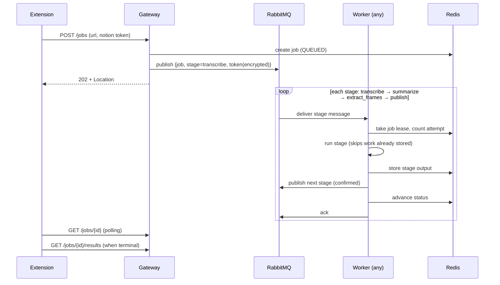

# Distributed Multimodal Video Note-Taking Agent: project document

This document covers what is built, how the assignment's requirements map onto the code, the functional and
non-functional requirements, the design decisions (and which could reasonably be made differently), what you
need to know to run and change it, and what is still to do. Setup steps are in the [README](../README.md).

Spec references such as **§6** point to sections of the assignment brief ("Project 2 — Specification").

---

## 1. Summary

| | |
|---|---|
| **What it does** | A Chrome extension sends a YouTube video to a backend that writes study notes (summary, takeaways, sectioned bullets), captures real frames at the moments the LLM flags as visually important, captions each frame, and publishes everything to a Notion page. |
| **Components** (§1.1) | Chrome MV3 extension · FastAPI gateway · RabbitMQ broker · worker pool (2 by default, scalable) · Redis state store. Each runs as its own process/container under one `docker-compose.yml`. |
| **Stack** | Python 3.12, FastAPI, aio-pika, redis-py (async), yt-dlp + Deno, youtube-transcript-api, ffmpeg, Pillow, google-genai (Gemini), httpx (Notion), plain-JS Chrome extension. |
| **Tests** | 131 automated tests (`pytest`), plus the live checks listed in §8. |

### 1.1 How a job flows

Each pipeline stage is its own broker message. A message is acknowledged only after the stage's output is in
Redis and the next stage's message has been confirmed by RabbitMQ. If a worker dies at any point, RabbitMQ
redelivers its unacknowledged message to another worker, which resumes from the stored outputs.

---

## 2. What is implemented

### Backend
- **Gateway** (`notetaker/gateway/`): job submission with URL and Notion-id validation, an `Idempotency-Key`
  header, read-only status polling with an optional history, a results endpoint that returns 409 until the job
  finishes, a health check with queue depths, Notion OAuth helper endpoints, a uniform error shape, and CORS for
  the extension.
- **Broker topology** (`infra/broker.py`): a quorum work queue `notes.jobs`, one TTL delay queue per backoff
  step (`notes.retry.<N>s`) that dead-letters back into the work queue, and the DLQ `notes.dlq`. Messages are
  persistent and publisher confirms are on.
- **Job state** (`infra/job_store.py`): Redis hashes with a Lua compare-and-set state machine, a per-job audit
  trail, stage artifacts (metadata, transcript, notes, frames, publish checkpoint) and TTL-based cleanup.
- **Job lease** (`infra/lease.py`): one worker per job at a time, auto-renewed, and expires within
  `LEASE_TTL_SEC` if its holder dies.
- **Global rate limiter** (`infra/rate_limiter.py`): atomic multi-quota sliding windows in Redis (LLM RPM + TPM
  per model, Notion RPS, YouTube RPM), plus a cooldown when a provider still returns 429.
- **Pipeline stages** (`pipeline/`): transcribe (metadata first, then Constraint A, then transcript), summarize
  (one call, or chunked map/reduce), extract_frames (concurrent ffmpeg captures with per-frame outcomes) and
  publish (destination resolution, frame uploads, page creation with crash-safe checkpoints).
- **Worker** (`worker/`): stale-message detection, attempt counting, retry with exponential backoff that honours
  `Retry-After`, dead-lettering, FAILED for non-retryable errors, abandoning work if the lease is lost, and
  graceful shutdown.
- **Fault injection** (`services/faults.py`): opt-in 429s and frame failures for demos.

### Extension (`extension/`)
- **Content script**: a "Take Notes" pill in the player toolbar that survives YouTube's in-app navigation and
  player re-renders, reads the video id at click time, shows a toast with the outcome, and sends an
  idempotency key with every click.
- **Background service worker**: Notion OAuth via `chrome.identity`, job submission, polling while jobs are
  active (with an alarm watchdog in case the worker is suspended), and a desktop notification on completion
  that opens the Notion page when clicked.
- **Popup**: Notion connection status, a "Take Notes" shortcut for the active tab, and one card per job showing
  the six-step stepper, progress bar, current sub-step, retry countdown, plain-language warnings and errors,
  "View in Notion" and dismiss.
- **Settings page**: gateway address with a connection test, Notion destination page, manual integration token,
  and the OAuth redirect URI to register.

---

## 3. Requirement traceability (spec → code)

| # | Spec | Requirement | Where it is met |
|---|---|---|---|
| R1 | §1.1 | Browser extension | `extension/` |
| R2 | §1.1 | Gateway accepts jobs and exposes status/results, **no pipeline work** | `gateway/routes_jobs.py::submit_job` only validates, records and enqueues |
| R3 | §1.1 | Durable broker, at-least-once delivery, redelivery on crash | RabbitMQ quorum queue + persistent messages + publisher confirms (`infra/broker.py`); ack is the last step (`worker/processor.py::handle`) |
| R4 | §1.1 | ≥ 2 independent worker processes | `docker-compose.yml` → `worker: deploy.replicas: 2`, `--scale worker=N` |
| R5 | §1.1 | Separate processes/containers | `docker-compose.yml` services: `rabbitmq`, `redis`, `gateway`, `worker` |
| R6 | §2 | "Take Notes" button in the player toolbar on watch pages | `extension/content.js::sync` (prepends into `.ytp-right-controls`) |
| R7 | §2 | On click, capture the current video id and send it to the background | `content.js::onClick` → `SUBMIT_JOB` message |
| R8 | §2 | Keeps working across video-to-video navigation | `yt-navigate-finish` / `yt-page-data-updated` / `popstate` listeners + `MutationObserver`; id read at click time. Verified on youtube.com (§8) |
| R9 | §2 | One-time Notion OAuth, token stored so the user isn't re-prompted | `lib/notion-auth.js` (`chrome.identity.launchWebAuthFlow`), `lib/storage.js`, gateway `POST /oauth/notion/token` |
| R10 | §2 | Background submits jobs and relays status to the popup | `background.js` (`SUBMIT_JOB`, polling, `chrome.storage` → popup `onChanged`) |
| R11 | §2 | Popup shows Queued → Transcribing → Summarizing → Extracting Frames → Publishing → Done | `popup.js::renderSteps`, `lib/format.js::STEPS` |
| R12 | §2 | One-click "View in Notion" | `popup.html .view-notion`; notification click also opens it |
| R13 | §2 | Failures and "completed with warnings" shown clearly; never raw JSON | `lib/format.js::describeError / describeWarning / describeActivity` |
| R14 | §3.1 | Timestamped transcript; learn true duration; enforce Constraint A | `pipeline/transcribe.py`, `services/youtube.py::fetch_metadata`, `services/transcripts.py` |
| R15 | §3.2 | LLM writes bullets + flags visual timestamps + a caption for each | `pipeline/synthesis.py` prompts, `domain/models.py::Notes / FrameSuggestion` (JSON schema output) |
| R16 | §3.2 | Chunk long transcripts and merge, keeping section order | `synthesis.py::chunk_segments` + ordered map calls + reduce call |
| R17 | §3.3 | Seek to each timestamp and capture one frame from the stream | `services/frames.py::FrameGrabber.grab` (ffmpeg `-ss` before `-i` on the stream URL) |
| R18 | §3.4 | Upload frames; build headings, bullets, captioned images via the Notion API | `pipeline/publish.py`, `pipeline/notion_page.py`, `services/notion.py::upload_image` |
| R19 | §4 | The nine statuses | `domain/status.py::JobStatus` |
| R20 | §4 | Transition table | `domain/status.py::ALLOWED_TRANSITIONS`, enforced by the Lua CAS in `job_store.transition` |
| R21 | §4 | COMPLETED vs COMPLETED_WITH_WARNINGS | `publish.run` → `final_status` |
| R22 | §5 | `POST /jobs` → 202, `Location`, `{job_id, status, video_id}` | `routes_jobs.submit_job` |
| R23 | §5 | Invalid input → 4xx `{"error": {"code", "message"}}` | `gateway/errors.py` (400 for bad URL/id, 422 for malformed body) |
| R24 | §5 | Token supplied per submission; gateway never stores it | Token is only Fernet-encrypted into the queue message (`infra/crypto.py`); never written to Redis or logs |
| R25 | §5 | Default destination when `notion_parent_id` is omitted, stated in the README | `publish.resolve_parent`; README "Default Notion destination" |
| R26 | §5 | `GET /jobs/{id}` read-only, idempotent; 404 for unknown | `routes_jobs.get_job` (no writes); test `test_status_poll_is_read_only` |
| R27 | §5 | `GET /jobs/{id}/results` → 409 before terminal; absolute Notion URL | `routes_jobs.get_results`; URL comes from Notion's `page.url` |
| R28 | §6 | 429s from **any** of the three APIs are re-queued with exponential backoff while retries remain | `RateLimitedError` from `services/llm.py`, `notion.py`, `youtube.py`, `transcripts.py` → `processor._retry_or_dead_letter` → delay queues (10s/30s/90s); popup shows the countdown |
| R29 | §6 | Worker crash → unacked message reassigned; no lost or duplicated jobs; ack after durable completion; stages idempotent | Ack last; job lease; stale-message check; artifact reuse in every stage; Notion page checkpoint + job-id marker reconciliation (`publish.find_existing_page`). Verified live (§8) |
| R30 | §6 | Graceful degradation: publish whatever frames succeeded; text-only if none | `extract_frames.py` (per-frame outcome, never raises for a frame), `publish.py` (omits failed frames, warns) |
| R31 | §6 | DLQ after a bounded, configurable, demonstrable number of attempts | `MAX_ATTEMPTS`, `RETRY_DELAYS_SEC`, `notes.dlq`, status `DEAD_LETTERED`. Verified live (§8) |
| R32 | §7 A | ≤ 20 min supported; longer rejected deterministically without processing | `transcribe._enforce_length` runs on metadata **before** the transcript is fetched → `FAILED / VIDEO_TOO_LONG` |
| R33 | §7 B | Only real frames; failures omitted, never substituted; every image paired with an LLM caption | ffmpeg capture only, `check_frame` rejects blank/corrupt frames, `validate_frames` / `validate_visual_frames` drop caption-less suggestions and (visual mode) any timestamp the model was not shown, `notion_page._frame_blocks` always sets a caption and a timestamp line; the vision model only chooses seconds, and the timestamp labels it sees are drawn on its low-res scan samples, never on published frames; the page has no thumbnails or embeds |
| R34 | §8 | Unpacked extension, no build step | Plain JS modules, `Load unpacked` |
| R35 | §8 | Gateway, broker, ≥ 2 workers in one compose file; scale/stop containers | `docker-compose.yml` |
| R36 | §8 | README: base URL, default destination, every env var (LLM key/model, rate limit, Notion OAuth creds, broker URL, retry/backoff) | `README.md`, `.env.example` |
| R37 | §8 | Health check confirming gateway, broker and state store | `GET /healthz` |
| R38 | §9 | Queue drains without LLM 429s under a burst | Shared sliding-window limiter. Verified live: 5 jobs, 3 workers, `LLM_RPM=2` → exactly 2 LLM calls per minute (§8) |
| R39 | §10 | Justify design choices | §6 of this document |

---

## 4. Functional requirements

| ID | Requirement | Status |
|---|---|---|
| FR-1 | Submit a YouTube video from a button in the player toolbar | ✅ |
| FR-2 | Submit the video in the active tab from the popup | ✅ (extra) |
| FR-3 | Connect Notion once (OAuth) or with an integration token | ✅ |
| FR-4 | Choose a Notion destination page/database, or fall back to a default | ✅ |
| FR-5 | Accept YouTube URL forms: `watch`, `youtu.be`, `shorts`, `embed`, `live`, `m.` | ✅ |
| FR-6 | Reject videos over 20 minutes and live streams with a clear message | ✅ |
| FR-7 | Fetch captions (manual first, then auto, then any language) | ✅ |
| FR-8 | Write a title, summary, key takeaways and timed sections with bullets | ✅ |
| FR-9 | Flag up to `MAX_FRAMES` visual moments, each with a caption | ✅ |
| FR-10 | Capture each flagged frame from the video stream | ✅ |
| FR-11 | Publish a Notion page with headings, bullets, captioned images and links back to the video at each timestamp | ✅ |
| FR-12 | Show live progress, the current sub-step, retries, warnings and errors in plain language | ✅ |
| FR-13 | Notify the user when a job finishes | ✅ |
| FR-14 | Expose status, results, health and history over REST | ✅ |
| FR-15 | Treat repeated clicks with the same idempotency key as one job | ✅ |
| FR-16 | Videos without captions: transcribe the audio instead | ❌ future (§9) |

## 5. Non-functional requirements

| ID | Quality | Target / approach | Status |
|---|---|---|---|
| NFR-1 | **Reliability** | At-least-once delivery, ack after durable completion, idempotent stages, no lost jobs | ✅ verified with SIGKILL |
| NFR-2 | **No duplicate side effects** | Job lease + stale-message check + publish checkpoints + marker-based page reconciliation | ✅ unit-tested crash-after-create; see §7 for the remaining window |
| NFR-3 | **Bounded retries** | `MAX_ATTEMPTS` per stage, exponential backoff, DLQ; repeated crashes also count | ✅ |
| NFR-4 | **Rate-limit compliance** | Global, atomic limits for the LLM, Notion and YouTube; cooldown on 429 | ✅ verified with a burst |
| NFR-5 | **Scalability** | Stateless workers; `--scale worker=N`; per-worker concurrency | ✅ |
| NFR-6 | **Recovery time** | ≤ `LEASE_TTL_SEC` (10s) + stage re-run time after a worker is killed | ✅ (~21s measured with the earlier 20s TTL) |
| NFR-7 | **Latency** | One LLM call for ≤ 20-min videos, concurrent frame capture via ffmpeg range seeks (≈1–4s per frame measured). Visual frame selection adds one pass over a 360p stream (≈110s for a 19-min video) and one vision call (≈1 min); `FRAME_SELECTION=transcript` skips both | ⚠️ end-to-end time with a real LLM key not measured here |
| NFR-8 | **Security** | Notion token encrypted in the queue and never stored or logged; OAuth client secret only on the server; a `state` check on OAuth; least-privilege extension permissions; untrusted titles rendered with `textContent` | ✅ (the gateway itself has no auth, see §9) |
| NFR-9 | **Observability** | Structured logs per component, `/healthz` with queue depths, per-job history (`?include=history`), `worker_id`/`attempt` in the status, RabbitMQ UI | ✅ (no metrics endpoint yet) |
| NFR-10 | **Usability** | No raw JSON; human messages and hints; retry countdown; light and dark themes; keyboard focus styles | ✅ |
| NFR-11 | **Configurability** | Every limit, budget and model is an env var | ✅ |
| NFR-12 | **Maintainability** | Layered package (domain → infra → services → pipeline → worker/gateway); LLM behind a protocol; pure functions for prompts and page layout | ✅ |
| NFR-13 | **Testability** | 131 tests with fakes (fakeredis + Lua, a mock Notion API, a fake LLM); no network needed | ✅ |
| NFR-14 | **Portability** | Everything in Docker; the extension needs no build | ✅ |

---

## 6. Design decisions and alternatives

These are the choices §10 leaves open, plus the ones the implementation had to make. **Each can be changed**; the
last column says roughly what that would involve.

| Topic | Chosen | Why | Alternatives (can be changed) |
|---|---|---|---|
| Broker | **RabbitMQ** quorum queue | Unacked messages are redelivered the moment a consumer's connection drops (fast crash recovery), native dead-lettering, publisher confirms, a management UI for inspecting the DLQ | Redis Streams (one fewer service, but crash recovery depends on an `XAUTOCLAIM` idle timeout, and delays/DLQ are hand-built), SQS, Kafka. Only `infra/broker.py` changes. |
| Retry delays | One TTL queue per backoff step, dead-lettering back to the work queue | Works on stock RabbitMQ with no plugins | The `rabbitmq_delayed_message_exchange` plugin (one exchange, arbitrary delays) |
| Message granularity | **One message per stage** | Ack really does happen after each stage's work is durable; a crash re-runs only one stage; the job waits in the queue between stages | One message per job with internal checkpoints (simpler, but a long unacked message and coarser retries) |
| Worker topology | **Generalist workers**, one queue | Simple, balanced load, any worker can resume any stage | A queue per stage with specialised pools (e.g. more frame workers). Route by `stage` in `Broker.publish_stage` and add a `WORKER_STAGES` setting. |
| Job state store | **Redis** hashes + Lua compare-and-set | Fast, already needed for leases and rate limits, TTL cleanup, AOF persistence | Postgres (stronger durability, SQL queries, long-term history). Swap `JobStore`. |
| State machine | Explicit transition table; status changes only through CAS | Illegal or late transitions are impossible; stale messages are detected by comparing stage with status | — |
| Duplicate protection | Per-job lease (Redis, TTL 10s) + stale-message check + stage artifacts + publish checkpoint + job-id marker on the Notion page | Covers both crashes and "zombie" workers that lost their broker connection | Fencing tokens on all writes; a transactional outbox; a Notion database property as a unique key |
| Global LLM rate limit | **Sliding windows** in Redis (atomic Lua across RPM + TPM, per model); callers wait for a slot | Exact "N per minute" semantics that match provider quotas; no bursts over the limit | A token bucket (smoother, but allows bursts at refill boundaries); re-queue instead of waiting (frees the worker, more messages); a central LLM dispatcher service |
| 429 handling | Counts toward the stage's attempt budget; delay = max(backoff step, `Retry-After`) | Keeps retries bounded as §6 requires | A separate, larger budget for throttling only |
| Private/unavailable video | **Retryable**, so it ends in the DLQ after `MAX_ATTEMPTS` | The spec suggests a private video as the natural DLQ trigger; availability can also be transient | Fail fast as `FAILED` (change `classify_ytdlp_error` to return `FatalError`) |
| Constraint A enforcement | In the worker's first stage, from yt-dlp metadata, before the transcript | Authoritative duration; keeps `POST /jobs` instant as §5 requires | Check at submission (≈2–5s extra on the 202), or trust a duration sent by the extension |
| LLM | **Gemini** via `google-genai`, JSON-schema output, optional fallback model | Long context (a 20-min transcript fits in one call), structured output, carried over from the prototype | Any provider implementing `LLMClient.generate(prompt, schema)` (OpenAI, Claude, a local model) |
| Frame selection | **Visual** (default): sample the video every 5s at 360p, label each sample with its timestamp, and have the vision model list the board/slide states and pick, per state, the sample where the content is most complete and least blocked by the presenter; then capture those seconds at 720p. Transcript-only mode remains as a setting and as the fallback | The transcript says when something is discussed, not whether it is legible: on whiteboard lectures the presenter often stands in front of the board, and boards are erased and rewritten. Labels inside the samples stop the model from confusing which of ~230 images is which; medium media resolution halves the token cost (≈530 vs ≈1100 per image) | The Gemini YouTube-URL video input (simpler, but bills the whole video and its timestamps are coarser); local person-detection to score occlusion (no model call, but needs a CV model in the worker image) |
| Transcript source | `youtube-transcript-api` (manual captions, then auto, then any language) | No API key, timestamps included | YouTube Data API captions (OAuth, owner-only); ASR (Whisper/Gemini audio) for videos without captions |
| Frame capture | ffmpeg seeking directly in the remote stream (range requests), JPEG ≤ 720p, blank-frame check | Downloads only a few hundred KB per frame | Download the whole video once (more robust to stream quirks, slower), or yt-dlp `download_ranges` per frame |
| Frame storage between stages | Base64 in Redis with the job TTL | Workers share no filesystem; frames are small (~30–50 KB) | Object storage (MinIO/S3) for larger frames or many jobs |
| Token transport | Fernet-encrypted inside each stage message | The gateway "never stores" the token (§5); a broker dump reveals nothing | Encrypted in Redis keyed by job; short-lived tokens from a token service |
| Default destination | Request → `NOTION_DEFAULT_PARENT_ID` → most recently edited top-level shared page → the shared root above the most recently edited page (walking up parents the integration can open) | Works with zero configuration after OAuth; the walk-up stops notes from nesting inside earlier notes when the shared page is not top-level | A template page duplicated during OAuth (`duplicated_template_id`); always create a "Video Notes" page |
| Notion API version | `2022-06-28` (configurable) | Stable; supports page and database parents and the file upload API | The newer data-source API version (database parents need `data_source_id`) |
| Extension tooling | Plain JS, MV3, no build | Loads unpacked directly (§8) | TypeScript + a bundler |
| Status delivery | Polling: 3s in the background while jobs are active, 2s while the popup is open, plus a 30s alarm watchdog | Simple and robust to service-worker suspension | Server-sent events or WebSocket from the gateway |
| Progress percentages | Fixed per status (0/5/25/55/85/100), refined by frame progress | Predictable | Time-based estimates from history |

---

## 7. Things to know

**Running**
- **Port 8000** may be taken by another app. Set `GATEWAY_PORT` and update the gateway address on the extension's
  Settings page.
- **`docker kill` stops a worker for good.** Restart policies don't apply to containers killed by hand; run
  `docker compose up -d` to bring it back.
- **The extension id is pinned** by the `key` in `manifest.json`, so the OAuth redirect URI is always
  `https://ebjbofalkfocmejjoggjeegajhihboae.chromiumapp.org/notion`. Removing the key changes the id.
- **`TOKEN_ENCRYPTION_KEY`** must be identical for the gateway and every worker. Changing it makes in-flight jobs
  fail with `CONFIG_ERROR`. The key in `.env.example` is a development key; generate your own for anything shared.

**YouTube**
- yt-dlp needs a JavaScript runtime (Deno is baked into the worker image) to solve YouTube's player challenges.
  YouTube changes often, so if extraction starts failing, rebuild the worker image with a newer `yt-dlp` pin.
- Some stream URLs return **403 until a few seconds after extraction** (`available_at`). `resolve_stream` waits
  for it; this was found and fixed during live testing.
- Datacenter IPs are more likely to be asked to "sign in to confirm you're not a bot". That is treated as a
  rate limit and retried; `YTDLP_COOKIES_FILE` is the escape hatch.

**RabbitMQ**
- Queue arguments are fixed at creation. Changing `QUEUE_DELIVERY_LIMIT` requires deleting `notes.jobs` (or the
  `rabbitmq-data` volume). Changing `RETRY_DELAYS_SEC` simply creates new `notes.retry.<N>s` queues.
- Inspect the DLQ at <http://localhost:15672> → Queues → `notes.dlq` → *Get messages*. The headers carry the job
  id, stage, error code and attempts. Re-driving jobs is not implemented (§9).

**Behaviour**
- **Recovery time vs. safety**: a redelivered job waits up to `LEASE_TTL_SEC` for the dead worker's lease to
  expire. A smaller value recovers faster; it must stay well above the renewal interval (TTL/3).
- **Waiting for a rate-limit slot holds a worker.** With a low `LLM_RPM` and many jobs, workers sit in
  "Waiting for LLM capacity" instead of running other stages.
- Attempts are counted **per stage** and reset when a stage succeeds.
- A frame stage that keeps failing to find a stream degrades to a text-only page on its **last** attempt instead
  of dead-lettering the job.
- Job state and artifacts expire after `JOB_TTL_SEC` (7 days). The extension then reports the job as unknown.
- **Remaining duplicate window**: pages with more than 100 blocks are written in batches. A crash between a
  successful append and its checkpoint can repeat one batch. Typical ≤ 20-minute notes fit in the first request,
  so this rarely applies.

**Tests**
- `pytest` runs entirely offline: fakeredis (with Lua) stands in for Redis, `httpx.MockTransport` serves a fake
  Notion API, and a fake LLM returns canned JSON.

---

## 8. Verification done

| Check | How | Result |
|---|---|---|
| Unit and integration tests | `pytest` | 131 passed |
| Stack starts and is healthy | `docker compose up`, `GET /healthz` | ✅ all checks ok |
| Real metadata + transcript | Job for `dQw4w9WgXcQ` in Docker | ✅ title and duration fetched; transcribe ran on worker A, summarize on worker B |
| Real frame capture | `resolve_stream` + ffmpeg in the worker container | ✅ 1280×720 frames in 1–4s each (after the `available_at` fix) |
| Retry → DLQ | Unavailable video, `MAX_ATTEMPTS=3`, `RETRY_DELAYS_SEC=2,4` | ✅ 2s → 4s → `DEAD_LETTERED`; message in `notes.dlq` |
| Worker crash | SIGKILL the worker holding the job mid-transcribe | ✅ the other worker took over (attempt 2) once the lease expired and the job continued |
| Shared rate limit | 5 jobs, 3 workers, `LLM_RPM=2` | ✅ LLM calls at +10s (2), +70s (2), +131s (1) |
| Popup and settings UI | Rendered with a stubbed `chrome` API and sample jobs, light and dark | ✅ all states readable; one `[hidden]` CSS bug found and fixed |
| Settings → gateway | "Test connection" against the running stack | ✅ |
| Content script on youtube.com | Injected into a live watch page, clicked, navigated in-app to another video, clicked again | ✅ button in `.ytp-right-controls`; still one button after navigation; sent the new video id |

**Not verified in this environment** (no real credentials were used):
- A full run with a **real Gemini key** (prompt quality, LLM latency, end-to-end time near 20 minutes).
- Publishing to **real Notion** (the publisher is tested against a mock of the Notion API) and the live
  **OAuth** round trip.
- The extension **installed in Chrome** end to end (the pieces were exercised separately as described above).

---

## 9. Not yet implemented / future work

| Area | Item |
|---|---|
| Pipeline | ASR fallback for videos without captions (Gemini audio or Whisper) |
| Pipeline | Refine visual selection: re-check the chosen 720p frames and try neighbouring seconds when the presenter still blocks part of the board |
| Pipeline | Support for videos over 20 minutes (chunked synthesis already exists; needs frame budgeting and latency work) |
| Operations | DLQ re-drive tool (move a job from `DEAD_LETTERED` back to its stage with a fresh budget) |
| Operations | Prometheus metrics (queue depth, stage latency, retries, 429s), tracing |
| Operations | Per-model daily quotas (RPD) in the rate limiter |
| Security | Authentication on the gateway (API keys or per-user sessions) and per-user quotas; currently anyone who can reach it can submit jobs |
| Security | Notion token refresh, if/when Notion issues expiring OAuth tokens |
| Scale | Per-stage queues and specialised worker pools; object storage for frames |
| Data | Long-term job history (Postgres) beyond the 7-day Redis TTL |
| Extension | Push updates (SSE) instead of polling; picking the Notion destination from a searchable list; Firefox support |
| Notion | Adopt the newer data-source API version |
| Quality | An LLM-as-judge evaluation harness for Constraints A/B on a fixed video set |
